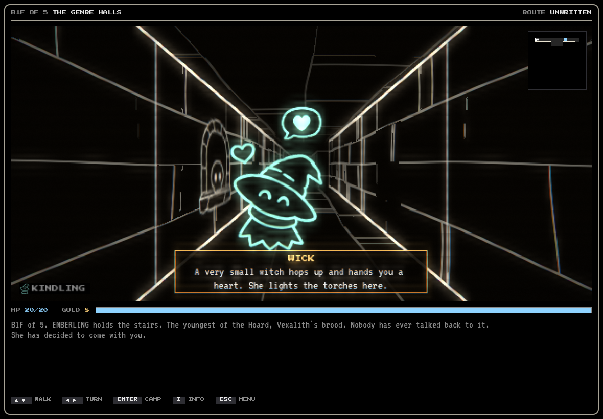

# Donjon



A Wizardry-style wireframe dungeon crawler with roguelike runs, rendered in 3D and drawn as the 2D line art it always was ("3渲2"). You can talk to the monsters, SMT-style. Every enemy decision comes from **Jev**, TypeSafe's System One model: what your words meant, whether it fights, flees, haggles or joins you, who it attacks, and what it says. Monsters you befriend join the party. They judge what you do and may walk out, or turn on you, mid-run.

Donjon is a Godot 4.7 project (GDScript). It runs in the browser, on Windows, on macOS and on Linux. Changes are listed in [CHANGELOG.md](CHANGELOG.md).

**Docs:** [The game](docs/GAME.md) (the screen, rules, monsters, Genre Halls, what Jev decides) · [Development](docs/DEVELOPMENT.md) (Jev setup, run flags, building, CI, tests, debug mode) · [Music and voices](docs/AUDIO.md) · [Architecture](docs/ARCHITECTURE.md) (how the Godot code is laid out) · [CHANGELOG](CHANGELOG.md)

## What you get

- **Monsters that listen.** In a fight you press T and say what you want. Each monster hears it, decides how it feels (delighted, offended, terrified, in stitches...), and acts on that: a joke can leave a slime too busy laughing to fight, flattery lowers a dragon's guard, a threat can make a goblin drop its gold. Every species likes and hates different things, so what works on one fails on another.
- **A party that grows.** Ask a monster to join and, if it likes you enough, it does. Up to three monsters travel beside your three adventurers. They fight on their own, they have values, and they react to what you do afterwards: kill a monster that was begging for mercy and the slime in your party notices.
- **Promises that count.** Swear a vow to an ally (*I WON'T KILL SLIMES*) and the game checks it against everything you do. Break it and the ally forgives you, leaves, attacks you or steals your gold.
- **Real dice.** Combat follows D&D 5e, simplified. Every roll shows in the log in words, and d20s tumble across the view. Spell slots, death saves, advantage, critical hits, levels.
- **A run worth restarting.** Floors are new mazes every time. Every flight of stairs earns a Roll of Fate (a random boon that stacks), every fifth floor has a red champion, and death is permanent.
- **It looks and sounds like a place.** Wireframe corridors and line-art monsters glow like an old vector monitor. They are a real 3D set now, drawn as lines: the camera glides down a corridor and swings round a corner, the monsters are models that stand in the corridor in front of you, and the floor's champion waits in its hall where you can see it from down the corridor. The screen drains of color, closes in red and starts a heartbeat when the party is dying. The music is original baroque dungeon music; every sound effect is synthesized.
- **A real main menu.** Continue, New Game, Load Game, a Save Manager (copy, rename, delete), Settings (window mode, vsync, frame rate, the CRT glow, calm hits, screen shake, sound) and Credits. Esc while walking pauses: resume, save, load, settings, back to the menu.
- **Genre Halls.** The game: Undertale-style battles on the same dungeon, where each faction attacks in its own genre (goo rain, chess, shadow, rhythm). The original turn-based Donjon stays behind the `main` flag.

## Run it

You need [Godot 4.7.2](https://godotengine.org/download). From the project folder:

```bash
godot --headless --path . --import   # once, and again after adding files or assets
godot --path .                       # play: the main menu, then Genre Halls (no key needed)
godot --path . -- main mock          # the original Donjon on mock Jev: no key, no credits
```

With no Jev key, the monsters run on **mock Jev**: random but well-formed answers, so everything works, but the monsters act at random instead of sensibly. The game says so in the log when that happens. [Setting up Jev](docs/DEVELOPMENT.md#setting-up-jev) puts a real key in. Everything after `--` is a [run flag](docs/DEVELOPMENT.md#run-flags).

Prebuilt web, Windows, macOS and Linux builds come out of CI: every push has them as workflow artifacts, and every `vX.Y.Z` tag becomes a [GitHub release](https://github.com/game-design-projects/final-project/releases) with all four zips. They carry no key; they reach Jev through a Worker that holds it. See [Building and publishing](docs/DEVELOPMENT.md#building-and-publishing). The web build opens from a web server only, not by double-clicking `index.html` (the page tells you; `python3 -m http.server` inside the unzipped folder is enough).

## Playing

| Where | Keys |
| --- | --- |
| Exploring | ↑/W forward · ↓/S back · ←/A and →/D turn · **C** camp (long rest; may be ambushed) · **E** talk to an ally · **V** make a vow to an ally · **B** boons · **M** map |
| Combat | **F** quick attack: everyone does their usual move at once (weapons; the wizard's free Fire Bolt; no spell slots) · **C** choose moves: pick each adventurer's action one by one (attack, Second Wind or Action Surge, or any spell they have slots for) · **T** talk (everyone hears) · **R** recruit the target · **G** give gold · **V** vow to the target · **E** escape · **1–3** pick target |
| Genre Halls | ↑/W forward · ↓/S back · ←/A and →/D turn · **Esc** pause menu (walking, or the fight's command menu) · in a fight **Enter** strikes, arrows dodge |
| Menus | ↑/↓ (or W/S) move the highlight, ←/→ jump columns, **Enter** picks it · **1–9** and **0** pick directly · **Esc** goes back |
| Anywhere | hold **Space** to talk · **K** achievements · **H** tips off / back on from the start · **P** music on/off · **O** sound effects on/off · **L** voices (monsters read aloud): the next voice, then off · (**J** Jev mind panel, debug runs only) |

Keys pressed with Cmd, Ctrl or Alt are left to the system. On the original Donjon's title card, any key starts the game and **G** opens [Genre Halls](docs/GAME.md#genre-halls-undertale-style-battles). Every key on the screen is also a button: click it.


More on the screen, the feelings, the vows and the rest: [docs/GAME.md](docs/GAME.md). Hold-to-talk speech recognition, voices and music are covered there and in [docs/AUDIO.md](docs/AUDIO.md).

## For developers

```bash
godot --headless --path . -s res://tests/run_tests.gd    # about 500 tests, under a minute
tools/build.sh web                                       # export to build/web/ and zip it
```

Run flags, the Jev provider setup, the Worker, CI, releases, the `cli/` scripts and debug mode are in [docs/DEVELOPMENT.md](docs/DEVELOPMENT.md). Agents working in this repo: see [AGENTS.md](AGENTS.md).
