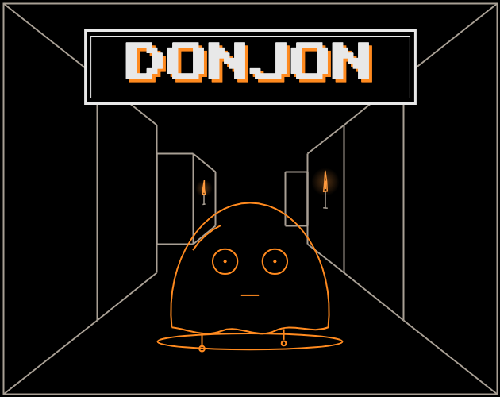

# Donjon



A Wizardry-style wireframe dungeon crawler with roguelike runs. You can talk to the monsters, SMT-style. Every enemy decision comes from **Jev**: what your words meant, whether it fights, flees, haggles or joins you, who it attacks, and what it says. Monsters you befriend join the party. They judge what you do and may walk out, or turn on you, mid-run.

```bash
npm run crawler              # http://localhost:5174
npm run crawler:mock         # the same, with Jev mocked: monsters act at random, no key, no credits
npm test                     # unit + API tests (node:test, mock Jev, no credits)
npm run crawler:scenarios    # scripted encounters, mock Jev by default; add -- --live to call the real API
npm run crawler:social       # group fights, ally talk and vows, likewise (-- --live for real calls)
```

The mock (`src/mock-jev.js`) answers every Jev question with a random but well-formed answer of the right type, seeded (`--seed=N`, or `JEV_SEED` for the server) so a run repeats. It exercises the plumbing and the game's rules, not Jev's judgement: use `--live` when you want to see what Jev actually decides.

The key comes from the project's `.env` (`TYPESAFE_API_KEY`) and stays on the server.

## Publishing on itch.io

itch.io only hosts static files, so the key can't go in the zip (anyone could open the files and take it). Instead, a small **Cloudflare Worker** (free tier) holds the key. The zip only knows the Worker's address.

**It's live** at `https://halls-of-jev-api.donjonjev.workers.dev` (the Worker keeps the game's old name, so this address stays the same). The game has no password, so anyone who plays (or finds that address) uses your TypeSafe credits. Watch your usage on the TypeSafe dashboard.

```bash
cd crawler/proxy
npx wrangler login                        # opens your browser to sign in to Cloudflare
npx wrangler secret put TYPESAFE_API_KEY  # paste your TypeSafe key
npx wrangler deploy                       # prints https://halls-of-jev-api.<you>.workers.dev
cd ../..
npm run crawler:itch -- https://halls-of-jev-api.<you>.workers.dev
```

**The itch build calls Jev on OpenRouter, from the browser.** OpenRouter serves TypeSafe's Jev (`~typesafe/jev-latest`, `POST https://openrouter.ai/api/alpha/decisions`, same questions and answers), and it allows calls from any web page. So the itch build needs no server: `OPENROUTER_API_KEY=... npm run crawler:itch -- --openrouter` ships the game's rules (`crawler/src` as `server/`) in the zip and puts the OpenRouter key in `config.js`. **That key is public** to anyone who opens the files, so it is a key with a small credit limit on purpose (cap it at openrouter.ai/settings/keys); rotate it if it's abused. The key is never committed: it lives in `.env` locally and in the `OPENROUTER_API_KEY` repository secret for CI. The local server also prefers `OPENROUTER_API_KEY` over `TYPESAFE_API_KEY` when both are set, and the Worker accepts either.

**CI publishes automatically.** `.github/workflows/ci.yml` runs `npm test` and builds and validates the itch bundle on every push and pull request; every push to `main` that passes is built with the OpenRouter key and pushed with butler to https://aalfalasi.itch.io/donjon (channel `html5`, version = the commit SHA). It needs the `BUTLER_API_KEY` and `OPENROUTER_API_KEY` repository secrets, and pull requests never see them.

To upload by hand instead, upload `dist/donjon-itch.zip` to itch.io as an **HTML** project and tick "This file will be played in the browser". The itch build turns debug mode on by default (its `config.js` sets `debug: true`), so the Jev mind panel shows beside the game: an embed size of about 1180 × 820 fits both; enable the fullscreen button too. Add `?nodebug` to the URL to play without it.

- The Worker runs the same code as the local server (`crawler/src/api.js`), so the monsters behave identically.
- To test the itch build locally: `node crawler/proxy/dev.js` (Worker on port 5175), then `npm run crawler:itch -- http://localhost:5175` and serve `dist/donjon` from any static server.
- To take the game offline, remove the key (`npx wrangler secret delete TYPESAFE_API_KEY` in `crawler/proxy`) or delete the Worker in the Cloudflare dashboard.

## Playing

| Where | Keys |
| --- | --- |
| Exploring | ↑/W forward · ↓/S back · ←/A and →/D turn · **C** camp (long rest; may be ambushed) · **E** talk to an ally · **V** make a vow to an ally · **B** boons · **M** map |
| Combat | **F** quick attack: everyone does their usual move at once (weapons; the wizard's free Fire Bolt; no spell slots) · **C** choose moves: pick each adventurer's action one by one (attack, Second Wind or Action Surge, or any spell they have slots for) · **T** talk (everyone hears) · **R** recruit the target · **G** give gold · **V** vow to the target · **E** escape · **1–3** pick target |
| Menus | ↑/↓ (or W/S) move the highlight, ←/→ jump columns, **Enter** picks it · **1–9** and **0** pick directly · **Esc** goes back |
| Anywhere | hold **Space** to talk · **K** achievements · **H** tips off / back on from the start · **P** music on/off · **O** sound effects on/off · **L** voices (monsters read aloud) on/off · (**J** Jev mind panel, debug runs only) |

**The screen.** The top line says where you are: the floor, the way you face (or that you're in a fight), gold, boons, and the switches as keycaps with pixel icons (H tips, P music, O sound, L voices; slashed red when off, hover for what they do). Beside the view sit **the party** (top) and the log; monster allies get one line each under an "ALLIES 2/3" count (the party holds six: your three adventurers and up to three monsters); the automap sits right under the view with a small key (you, stairs down, the champion), and steps aside in a fight. Everything you can do sits in the **command dock right under the view**, as keycap buttons: press the key or click the button. Hover a button to read what it does on the line beneath. When the game waits on you (a menu like CHOOSE MOVES' spell list, the talk box, "any key" after a Roll of Fate), the dock lights up in the floor's color, and a key it doesn't take shakes it instead of vanishing.

**Questions wait where you're looking.** When the game needs a yes or no (stairs down, Revivify, a monster asking to join), a box lights up over the view in the floor's accent color with clickable answers. **Y**/**Enter** says yes, **N**/**Esc** no, and any other key shakes the box so you can't miss it. At the stairs you can simply walk away.

**The party panel** reads at a glance, mostly without words. While you choose moves, the member choosing glows with a ▶; while you pick who to heal or revive, the one highlighted in the menu lights up here too:

- **Health** is a segmented bar: its length and color say how hurt someone is (green healthy, yellow HURT, red CRITICAL). At 0 it reads DYING (blinking) with their death saves as boxes, three green for successes and three red for failures; STABLE once three succeed; the dead get a skull and a struck-through name.
- **Armor** is a shield with the number an attacker has to reach.
- **Spells** are pips, one per spell slot, colored by circle (blue first, violet second, gold third); lit pips are left, hollow ones are spent. The fighter's two pips are Second Wind and Action Surge. In the CHOOSE MOVES menu each spell shows the same colored pips for the slots it would draw on, or FREE.
- **Status** chips pair a pixel icon with a word: POISONED (droplet), ENTANGLED (chain), KNOCKED DOWN (arrow), an ally's loyalty (heart: DEVOTED, CONTENT, UNEASY, RESENTFUL, MAY LEAVE), its talk buff (PUMPED, BOUNCY, ...) or mood. Monsters in a fight wear the same icons over their health bars (ASLEEP, PARALYZED, ENRAGED, SCARED, VETERAN, ...).

Hover any of them for the details (exact numbers, ability scores, boons).

**Monsters answer out loud.** With the browser's built-in text to speech (Chrome, Edge, Safari), monsters and allies read their lines aloud, each kind in its own pitch and pace (a deep, slow dragon; a squeaky slime), in an English voice, skipping the *stage directions*. It starts off, and turns on by itself the first time you talk to the game with your voice: someone speaking to the monsters wants to hear them answer. **L** turns it on or off for good. Speech can't be turned up past the browser's full volume, so while a monster talks the music drops to a quarter and the effects to half, then come back as it finishes. It goes quiet while the microphone listens, and drops a backlog rather than falling behind the fight (`public/tts.js`).

**Hold Space to talk.** Instead of typing, hold **Space**, say it, and let go: the words fill the talk box as you speak and are sent when you let go. In a fight it talks to the monsters (like T); exploring, it talks to a monster ally (like E; pick one first if you have several); with a talk box already open and empty (after T, R or E) it just listens. A quick tap of Space is still an ordinary key, and with words already in the box Space types a space. On a phone or with a mouse, press and hold the **HOLD TO SPEAK** button beside the box. It uses the browser's built-in speech recognition (Web Speech API: Chrome, Edge and Safari; Chrome sends the audio to Google's recognizer, Safari to Apple's), in the browser's language, and asks for the microphone the first time. Where it's missing (Firefox) the button hides and holding acts like a tap. The logic is `public/voice.js`.

**Achievements.** Thirty of them, for what makes this game itself rather than for grinding: words that leave a monster DELIGHTED or IN STITCHES, a fight won without a single attack, your first ally, a shiny, three monster allies at once, a vow carried down the stairs (or broken and forgiven), a natural 20 while talking, a death save that pulls someone back up, floors 5 and 10, a red champion slain or talked down, a legendary boon. A few are secret and read **???** until you stumble on them. When you earn one, a gold note slides down over the top of the view with a short jingle (the **O** toggle mutes it) and the log says so; it never takes a key or a click away from you. **K** (or the trophy keycap in the top bar, which also shows your count) lists them all over the view: earned ones lit in their group's color with the date, locked ones dimmed with what to do, and progress bars for the two that count up across runs (EMPATH, every feeling; MENAGERIE, every kind of monster). While the list is open it glows, **K** or **Esc** closes it, the arrows scroll it, and any other key shakes it. Achievements are kept in `localStorage` (`donjon.achievements`) across runs, deaths and reloads. The list and its rules live in `public/achievements.js`; the game calls it from one-line hooks.

**Tips.** New players get one short hint at a time, the first time each thing matters: how to walk, the automap, the stairs, your first fight (and that you can talk), targeting, feelings, a monster warming to you, your first ally, camping when hurt, levelling up, someone going down, a champion's floor. Each shows once, in a framed note over the bottom of the view, and lights up what it talks about (the keys' buttons, the map, the party). It never blocks anything: your next key does its job and clears the hint, and a key that does nothing nudges it instead. **H** turns tips off; **H** again turns them back on from the start. Seen tips are remembered in `localStorage` (`hallsOfJev.tipsSeen`, `hallsOfJev.tipsOff`). The hints and their wording live in `public/tutorial.js`. **Your first fight is a lesson**: one shy slime, and only TALK works (it glows, the rest wait, dimmed), then only RECRUIT, and the slime always says yes. It's how you learn that monsters here listen and can join you. It happens once (H off skips it; H back on replays it); every later fight is yours.

### D&D-style combat

The rules follow D&D 5e, simplified (`public/dnd.js`). Every roll is shown in the log, in words, e.g. `HORTENSE ATTACKS KRUNK: ROLLED 16 (ADVANTAGE) +5 = 21 VS ARMOR 12. HIT! 7 DAMAGE.` Saving throws read `ROLLED 9, NEEDED 15`, spell descriptions give damage as a range (`8-48 FIRE TO EVERY ENEMY`) rather than dice notation, and floors are FLOOR 1, FLOOR 2... in the game (B1F below is the same thing).

- **The party:** HORTENSE is a fighter (longsword, AC 16, Second Wind and Action Surge once per rest, a second attack at level 5). ROLF is a cleric (mace, healing and holy spells). EUGENE is a wizard (Fire Bolt and attack spells). Each has ability modifiers; hover a party row to see them. The game calls armor class ARMOR, hit points HEALTH and experience EXPERIENCE on screen.
- **Initiative:** each fight opens with a d20 roll for each side. Whoever wins acts first.
- **Attacks:** d20 + proficiency + ability against the target's armor class. A natural 20 is a critical hit and rolls the damage dice twice; a natural 1 always misses.
- **Advantage:** roll two d20s and keep the higher. You get it against monsters that are asleep, paralyzed, glowing from Guiding Bolt, or off guard from flattery. Disadvantage (keep the lower) comes from being poisoned or restrained, or attacking a monster that is dodging.
- **Spells use slots** on the 5e table (2 first-circle slots at level 1, up to third-circle spells at level 5). Cantrips are free and roll a second die from level 5. Camping restores slots.
  - Wizard: Fire Bolt, Magic Missile, Burning Hands, Sleep, Scorching Ray, Hold Monster, Fireball.
  - Cleric: Sacred Flame, Cure Wounds, Bless, Guiding Bolt, Prayer of Healing, Revivify, Spirit Guardians.
- **Saving throws:** area spells, Hold Monster and monster specials call for a save against a DC; a success halves the damage or avoids the effect. From B3F, monster specials also poison, entangle (restrained) or knock down (prone, losing your next action).
- **Death saves:** at 0 HP a member falls unconscious instead of dying. At the start of each of your turns they roll a d20: 10+ is a success and below 10 a failure. Three successes stabilize them, three failures kill them, and a natural 20 brings them back with 1 HP. Any healing gets them up, and after a fight they come to with 1 HP. The dead can be brought back with Revivify, in a fight or while camping.
- **Monster allies** act on their own each round: an attack, or their species' special every few rounds.

### Talking always matters

- **Charisma checks:** when you talk, your best talker rolls Charisma. A strong roll makes your words land harder (up to ×2 on a natural 20); a natural 1 halves them.
- **Feelings:** every time you talk to monsters, pay them, or ask them to join, Jev picks how each one **feels**, and code gives every feeling a visible effect (`public/emotions.js`):

  | Feeling | Effect |
  | --- | --- |
  | DELIGHTED | won't attack this round |
  | IN STITCHES | too busy laughing to fight |
  | TOUCHED | its heart opens: it won't attack you this round, and if it likes you enough it asks to come along |
  | FLATTERED | lowers its guard: you get advantage against it |
  | INTRIGUED | lets slip a weak spot: +2 to hit it for the rest of the fight |
  | CONFUSED | loses its turn |
  | SADDENED | disadvantage on its attacks |
  | OFFENDED | +2 damage against you |
  | ENRAGED | advantage and +3 damage, but reckless (armor −3) |
  | TERRIFIED | disadvantage on attacks, and it drops gold |

  Each feeling also moves its friendliness, anger or fear. You never see those numbers: you read the mood the way you would at a table, from what it says and how it moves. The log narrates a tell for every feeling ("Grak lets its big ears droop."), and when a monster changes sides ("the fight has gone out of it", "You've made an enemy").
- **Recruit (R):** ask your target to join, with or without words. Your talker rolls Persuasion against a DC set by how much it likes you, how angry it is, and whether it is losing. A convincing or irresistible pitch brings it up to the point where it would consider joining; a close, clumsy or disastrous one only nudges (or sours) its mood. Then the monster answers in character, and the log always says why, so what it seems to feel and what it does agree:
  - *"Grak grins, showing crooked teeth, but grunts that it won't leave Snag."* (likes you, but won't abandon its brother)
  - *"Glop still quivers a little, but burbles that it won't be alone down here anymore."* (unsure of you, but comes anyway)
  - *"Drip wobbles from side to side and burbles that it didn't like how you asked."* (a botched pitch to a friend)

  Reasons to refuse: it doesn't know you well enough yet, wants more first, is still angry, didn't like how you asked, won't leave the others with it, is too proud, won't leave its home, is afraid of what lies deeper, or you let it down before. Reasons to come: it likes you, respects your strength, wants gold and loot, is lonely, wants to be with its kind in your party, feels safer with you, is curious, or is grateful. Winning a monster over, or letting it leave in peace, gives half its XP.
- **Ally talks (E)** always have a result, by how your words land (0–4): it sulks and sits out the next fight, gets distracted (−2 to hit), feels steady (+1 to hit), gets its species buff, or is inspired (buff, full heal and a level).

### Floors and champions

- **Complexity grows as you descend.** B1F is a small maze with lone slimes and goblins. B2F brings pairs, bandits and snake people; B3F groups of three, rock entities, and specials that inflict conditions; B4F dragons and wider halls; B6F veteran monsters. Each new rule is announced when you arrive.
- **Every 5th floor** has a 5×5 hall at its heart with a **red champion** in the middle, marked red on your map and visible down the corridor. It is a normal monster of its kind but far harder: about 2× the HP, two attacks a turn, a faster special, better saves, and Legendary Resistance against the first two Sleep or Hold spells. You can still talk to it and recruit it, though it takes more to impress.
- Killing it, winning it over, or talking it into leaving earns a **Great Roll of Fate**: a boon at double strength, with a 60% chance of a legendary one (PHOENIX FEATHER, LEGENDARY ARMS, ARCHMAGE'S CROWN, TITAN'S BLOOD, TWIN SOUL). It's optional: the stairs are elsewhere.

### Roguelike progression

- **Roll of Fate:** every time you take the stairs down, you roll one random boon. Its strength scales with the floor you just cleared, and boons stack. The pool:
  - WHETSTONE: +12% damage per floor of depth, multiplying with earlier ones
  - KEEN EYE: crit on a wider range (19–20, then 18–20, down to 15–20)
  - TRUE AIM: + to hit
  - FLURRY: strikes per turn go 1× → 2× → 3× → 4× → 8×
  - IRON SKIN: higher AC
  - VAMPIRIC EDGE: heal a share of damage dealt
  - ARCANE SURGE: a caster gets more spell slots and stronger spells
  - VIGOR: max HP for the whole party
  - GOLDEN TOUCH: more gold from monsters
  
  Press **B** to list your boons, or hover a party row to see that member's stats.
- **Balance:** monster HP grows 1.3× per floor and damage 1.1× per floor. Armor and to-hit creep up slowly, as in 5e, so your dice keep mattering.
- **Levels:** each party member earns XP and levels up on their own, gaining HP, proficiency, spell slots and new spells, as in 5e. Recruited monsters join at the current floor's level.
- **The view** (`public/render.js`) is a true perspective projection of the maze, six cells deep: walls are painted far to near so nearer ones hide what's behind, side passages open into the rooms and halls that are really there, and lines fade into the dark with distance. The automap fills in only floor you have actually seen, and draws the walls beside it as lines.
- **Floors:** each one gets a random color theme (Bone Crypt, Blood Vault, Frost Warrens and others). Walls carry torches that flicker and glow, chains, banners, barred windows, skull niches and cracks. Placement is seeded per floor, so decorations stay put as you move.
- **Sound effects** (`public/sfx.js`) are synthesized live, with no sound files: hits, crits, misses, kills, spells, heals, dice, feelings, joins, level-ups, and the Roll of Fate's ticking spin and landing fanfare.

### Groups, ally talks and vows

- **Groups.** You can meet 1–3 monsters at once, possibly of different species, and one Jev request decides all their moves each round. Monsters see which side the others are on. When one warms to the party, the rest hear it "sided with the party against them", and a hostile monster may club the turncoat. A friendly monster that gets attacked by its own group may flee. Code only lets a monster turn on another when they're on opposite sides or one hit the other.
- **Rolled on Jev's odds.** Monsters don't always take Jev's top choice. Any action at 15% or more can happen, in proportion to its probability. Jev's probabilities are calibrated, so a 20% "turn on the traitor" really happens about one time in five.
- **Talking to allies (E).** Each ally hears you once per floor. If your words land well (3+ out of 4), it gets a buff for the next fight: goblin **PUMPED** (double damage), slime **BOUNCY** (absorbs a hit), dragon **STORMING** (free lightning on every enemy), and so on. Worse results have consequences too (see above).
- **Vows (V).** Build a promise from menus: *I WILL / I WON'T* → *KILL / TALK TO / GIVE GOLD TO / RUN FROM / BEFRIEND* → *SLIMES / GOBLINS / DRAGONS / MONSTERS*. Swear to an ally (once per ally per floor) or to the monster you're targeting (once per fight). Jev judges how the monster feels about the promise, which shifts friendliness or loyalty.
- **Breaking vows.** Because vows are structured, code checks them exactly against what you do (killing, sparing, talking, paying, fleeing, attacking, recruiting). A broken vow gets slashed in the ledger, and the monster you swore to responds, with Jev picking one of:
  - **forgive** (only if loyalty is still at least 35)
  - **leave the party**
  - **attack you** (a fight where you can win it back, though rejoining takes more friendliness than before)
  - **steal your gold** (60% chance to get away with 25–50% of it; otherwise you catch it)

  If you swore to a monster that's still in the fight, it gets angry instead. If the one you swore to is gone, nobody holds you to it.

- **Allies explain themselves.** After a fight, each ally's reaction line matches how it judged you, and the log names the moment it can't get past ("Glop can't stomach how you killed Drip while it begged for mercy.") or liked. An ally that nearly walked out "stays. For now." A betrayed ally that wanted to forgive you but can't says so before it leaves.

Test these against the live API with `node crawler/scripts/social-scenarios.js`, or in the browser in debug mode with `halls.meet("goblin", "slime")`, `halls.hostile("slime")`, `halls.ally("slime", "Glop")`, and the guided first fight with `halls.lesson()`.

### Debug mode (developers only)

**Every API request, in detail.** In debug mode the Jev panel has a **REQUESTS** tab: every call the game makes to its server, newest first, with its status, time, how many Jev calls it took, questions and tokens. Open one to read exactly what was sent and answered, and below it each raw Jev call: the `state` Jev was given, the `questions`, and its `answers` with all their probabilities, each with a COPY button. The game asks the server for this with `?debug=1`; the server then records every Jev call for that request alone and returns them under `_debug` (never the key). A server or Worker older than this sends no details, and the tab says so.

Locally, players never see Jev's raw output. Open the game with `?debug` or `#debug` in the URL (e.g. `http://localhost:5174/?debug` or `#floor5-debug`), or set `localStorage["donjon.debug"] = "1"`, to get the following (the itch.io build has it on by default; `?nodebug` turns it off):
- the **Jev mind panel** (toggle with **J**): every monster's meters, what it heard, Jev's action odds, its feeling odds, its answer to an invitation and the reason, every choice code blocked, and how allies scored each fight;
- `[DEBUG]` lines in the log with the numbers behind feelings, ally talks, vows and loyalty changes;
- the `halls` console hooks.

The server also logs one `[join]` line per invitation answer (who, yes or no, the reason, and the numbers behind it).

**Test runs:** open http://localhost:5174/#floor5 (any number) to start on that floor with a party that got there: every member at that level, one Roll of Fate boon per floor cleared, some gold, fully rested. Add `-debug` (`#floor5-debug`) to also get debug mode (see above).

Floors are new mazes every time you descend. Death is permanent, and your deepest floor is remembered.

## Genre Halls: Undertale-style battles

`public/genre-halls.html` (http://localhost:5174/genre-halls.html, also in the itch zip) is a pitch for the next version of the fights, built on the same renderer, monster art, species, feelings and synth. It runs entirely in the browser.

- **One floor, five fights.** A 13×13 maze holds one slime, bandit, snake person and rock entity, plus a red dragon champion in the 5×5 hall at the center. Monsters are drawn down the corridor when you can see them, and show on the automap.
- **One box, one rule: lit squares hurt.** When a monster attacks, you dodge on a 7×7 grid with the arrow keys. Every faction attacks in its own genre. Slimes rain goo, and the shadow of each drop shows where it will land. Bandits play chess: a rook lights its row and column, a bishop its diagonals, a knight its L-jumps. Snake people swing a lantern around the box, and you hide in a pillar's shadow. Rock entities stomp on the beat, with each pattern shown two beats ahead. The champion changes genre every turn.
- **FIGHT, ACT, SPARE, FLEE.** FIGHT is a timing bar: strike when the line crosses the middle. ACT gives CHECK, three acts for that species (a slime likes jokes, a bandit a fair cut, a rock quiet), and SAY SOMETHING, a typed line once per fight. SPARE works when the monster's mercy odds are 50% or more. Champions can't be fled.
- **The mind.** Each act asks the same kinds of question the main game asks Jev: how it feels (a choice over the ten feelings in `public/emotions.js`), whether it accepts mercy (yes/no), and how hard it attacks (a 0–3 score). Here a local stand-in answers them from the species' tastes, two rolled traits and its friendliness, anger and fear. Typed words are read by keyword cues and a nonsense detector. The Jev mind panel shows every answer and its odds. As in the main game, any answer at 15% or more can happen.
- **Allies are charms.** A spared monster may ask to join, up to three. Each ally gives a passive charm: BOUNCY absorbs the first hit, KEEN EYE keeps warnings lit longer, SLIPPERY lengthens your safety after a hit, STEADY slows the strike bar, and HOARD-FIRE adds 4 damage. Allies judge what you do (killing a monster that was ready to stop, fleeing, insults) and walk out when their loyalty runs low.
- **Routes.** The stairs name how you played: ghost (met no one), quiet (killed no one), blood (spared no one) or tangled.

The rules (factions, floor, mind, word reading, box geometry) are in `public/genre-rules.js`, with no DOM, and are tested in `test/genre-halls.test.js`. Drawing and input are in `public/genre-halls.js`. In the console, `genreHalls.meet("rock")` jumps straight into that faction's fight.

## The monsters

| | Likes | Hates | As an ally, it cares about |
| --- | --- | --- | --- |
| **Orange slime** | kindness, jokes, peace | cruelty, killing slimes, being called gross | a gentle party that makes friends instead of killing |
| **Huge brown goblin** | gold, fighting, being called strong | being bossed, insults, cheap offers | loot and victories; hates giving gold away and running |
| **Yellow dragon** | flattery, courage, treasure, wit | rudeness, cowardice, cheap tribute | bold wins; disgusted by fleeing and cruelty |
| **Snake person** | clever bargains, secrets, compliments on its scales | being rushed, clumsy lies, loud brutes | cunning deals and promises kept; hates pointless brutality |
| **Rock entity** | patience, quiet, respect for old things | being hurried, noise, greed | a calm, steady party; hates waste, greed and panicked running |
| **Bandit** (human) | gold, a fair cut, clever tricks | being looked down on, cheapskates | profit and fair shares; hates gold given to monsters |

Any monster (except a champion) has a **15% chance to be shiny**: drawn in metallic gold with twinkling glints. Shinies are tougher (+30% HP, +1 AC, +1 to hit, saves and special DC, +10% damage) and worth double gold and 1.5× XP. They know they're rare and are proud of it. **Recruit one and you get a Shiny Roll of Fate** after the fight: a normal-strength boon, on top of the one you get for the stairs. A recruited shiny keeps its stronger stats. Talking well to an ally earns a species buff for the next fight: slime BOUNCY, goblin PUMPED, dragon STORMING, snake VENOMOUS, rock BULWARK, bandit SNEAKY.

**Dev pages** (local only, left out of the itch build): `gallery.html` shows every monster, with the jaggedness and shiny toggles (the game uses smooth lines; `ART.pixel` in `public/art.js`); `cover.html` draws the itch.io cover (saved as `assets/donjon-cover.png`, 630 × 500); `beatmaker.html` is the step sequencer whose SAVE TO GAME writes `song.json`.

So allies conflict with each other. Killing a monster that was pleading pleases a goblin and upsets a slime.

## How Jev runs it

**Each combat round:** one Jev request (`src/enemy.js`, about 10–25 questions per monster, ~150–300 ms):
- It reads your message: threat, insult, kindness 0–3, joke, offers gold, asks it to join, asks for peace.
- It picks an action from the feasible set and a target from the living party members.
- It also picks one line per possible action from that species' approved lines in `public/species.js`, so whatever action survives the rules already has a line.
- Whenever joining is possible (you recruited it, your words invite it, or it's warm enough to ask): whether it wants to say yes, plus its main reason to say yes **and** its main reason to say no (both asked at once, since Jev answers in parallel).

**Code owns the rules:**
- Your words move the monster's friendliness, anger and fear, using per-species weights.
- A monster can only join once it's friendly enough (the slime's bar is lower than the dragon's) and calm enough. The answer to an invitation (`resolveJoin`) is settled from its mood *after* this round's pitch, words and feeling, plus Jev's yes/no; code then keeps the reason that matches the outcome (an angry refusal always gets an angry reason). Feeling offended, enraged or confused that same round rules out a yes. A monster that likes you and says no declines instead of attacking.
- Tribute must meet the monster's minimum. Code describes the offer in words ("a generous offer") because Jev compares words better than numbers. A refusal says whether the offer was too small, it's too angry, or it can't be bought.
- An angry monster can't just walk away.
- `public/narrate.js` turns all of this into the log: species body language, and the reason behind an answer. Shared by the browser and the server; it never shows a number.

**After each encounter:** one request (`src/allies.js`) scores how each ally feels about what happened, from 0 to 4, by its own values, and picks the moment it reacted to most. Code turns the score into loyalty and picks the reaction line Jev liked best *among the lines that match the score*, so a disapproving ally never cheers (ally talks and vows do the same). Allies below 45 loyalty are also asked whether they stay, leave or turn on you. Code only allows leaving below 30 and betrayal below 15. A betrayer becomes an enemy that remembers why.

## Music

The music follows the moment (`public/ambient.js`). **P** turns it on and off.

All of it is baroque dungeon music, in the spirit of Wizardry and Dragon Quest: one small band of real samples (harpsichord, church organ, strings, choir, music box and tubular bells, from the MusyngKite soundfont) plus synthesised kettle drums and a tabor, all in the same stone hall. Every piece is built on the game's own melody, **A B C D D D E D E D C C C D D D**, with its repeated notes short-short-long.

**Exploring: `public/ambient.m4a`**, a passacaglia in D minor: 112.5 seconds, 3/4 at 64 BPM, five variations on an eight-bar ground bass (the lament D C B♭ A, then B♭ A D A). The melody lies over it note for note (Dm | C | B♭ | F/A | Gm/B♭ | A7 | Dm | A) and comes and goes. Variation I has no melody, only organ, low strings, harpsichord and a far bell. Then the melody passes to the music box, the strings, and the harpsichord over a swelling choir, and in the last variation a fragment on high strings while the texture thins back to the start. The ambient also comes and goes in time: about a minute and a half of music, then a minute or two of quiet before it drifts back. It fades in over two seconds, two seconds after a fight ends.

**Fights: four toccata-style loops, picked at random** (`public/battle-*.m4a`). Each is 16 bars: the melody in the minor, again coming home with a string run, lifted into the relative major on a second lead, then everyone together.

| Loop | Key, tempo | Lead (and the major lift) | Groove |
| --- | --- | --- | --- |
| toccata | D minor, 132 BPM | organ (strings, F major) | harpsichord 16ths against a pedal note, pumping bass, strings marcato |
| charge | A minor, 126 BPM | strings (choir, C major) | harpsichord arpeggios, organ chords, driving kettle drums |
| crusade | G minor, 112 BPM | choir (strings, B♭ major) | full organ, chugging strings, kettle drums and tabor in march time |
| gallop | E minor, 120 BPM | harpsichord (organ, G major) | galloping strings, kettle drums and tabor |

None goes faster than 132 BPM. Each fight picks one at random, never the one you heard last, and keeps it for the whole fight, because switching tunes mid-fight was jarring. The loop cuts in within a third of a second when a fight starts, and the ambient fades out underneath, keeping its place.

**Good news: one-shot cues** by the same band. `fanfare.m4a` (3.9 s) plays when you go down the stairs, and the ambient returns a few seconds after it. `victory.m4a` (2.3 s) plays when you win a fight (every foe killed, driven off, won over or let go; not when you run). Both quote the melody's opening in D major (D E F♯ G G G) and land on a IV6–V7–I cadence with bells.

**Levels.** The renders are mastered to −19 dBFS RMS (explore) and −17 dBFS RMS (fights and stings). The volumes in `TRACKS`/`STINGS` (0.7 and 0.75) put a fight at about −19.5 dB, as loud against the sound effects as the music it replaced, with exploring about 2.6 dB under it. Total music is about 5 MB.

**How it's made.** `scripts/sampler.py` is an offline sampler. It decodes each soundfont key once, fixes the samples' tuning where two pitch estimators agree (the harpsichord runs up to 14 cents sharp), loops long organ, string and choir notes, and renders into a circular timeline so the loop points are seamless. The notes, chords and mix levels are tables at the top of each build script. Each build prints its bar-by-bar chord and melody table, a check of the outer voices for parallel fifths and octaves, the loudness of every part per section, and the peak, RMS, spectrum and loop seam. To change one and rebuild (needs numpy and scipy):

```bash
uv venv /tmp/donjon-music-venv && source /tmp/donjon-music-venv/bin/activate && uv pip install numpy scipy
python3 crawler/scripts/build-ambient.py /tmp      # ambient.wav
python3 crawler/scripts/build-battle.py /tmp       # battle-toccata/charge/crusade/gallop.wav
python3 crawler/scripts/build-stings.py /tmp       # fanfare.wav and victory.wav
for n in ambient battle-toccata battle-charge battle-crusade battle-gallop fanfare victory; do
  afconvert -f m4af -d aac -b 160000 /tmp/$n.wav crawler/public/$n.m4a
done
```

Loop files hold one loop plus a repeat of its first second, so the player loops inside the file and the encoder's padding at the edges is never heard. If you change a loop's tempo or length, update its `loopSeconds` in `TRACKS` (`public/ambient.js`); tests check they match. The soundfonts stay out of the itch build; only the rendered `.m4a` files ship.

**The beat maker and its engine are separate now.** The dungeon no longer plays what follows; it is still there for `beatmaker.html`.

The engine (`public/music.js`) plays sampled instruments from the **MusyngKite** soundfont (CC BY-SA 3.0) and **FluidR3** (CC BY 3.0), plus **LinnDrum** drum samples (public domain), through a generated cathedral reverb. Every track can use any instrument. Credits are in `public/CREDITS.txt`, which ships in the itch zip; put the same credits on the itch.io page.

The game's theme is **Beethoven's Symphony No. 7, Allegretto, bars 3–50**: the hypnotic repeated-E theme, then the singing counter-melody over it. Every note comes from a public-domain score (Mutopia Project MIDI in `assets/`). `scripts/build-theme.js` arranges it into `public/theme.json` as layers: strings on every part, a choir doubling the violas, a dark synth pad under the cellos, a sub bass an octave below the basses, and a soft kick heartbeat. Change the `ARRANGEMENT` table (instrument, volume, octave) and rerun `node crawler/scripts/build-theme.js`. Or open the beat maker, where each score layer can be re-voiced, rebalanced or muted, and you can add your own drums and notes on top.

**Older notes:**

`public/music.js`, soundfont samples (FluidR3 GM: warm pad, synth bass, saw lead) plus a synthesized kick for the thumps. Your melody **A B C D D D E D E D C C C D D D** is kept note for note:
- It's set in A minor over **Am | F | Dm | E**.
- It's given a rhythm (the D-D-D repeats land as short-short-long), and each 4-bar phrase gets an ending (E D C B, then E D C B G#) that pulls back to A.
- The second phrase lifts to F over the F chord.
- The first four bars are just pad, bass and thumps.

Edit the `SONG` object at the top of the file: note names plus lengths in eighth notes.
