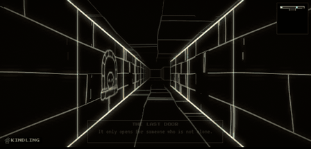
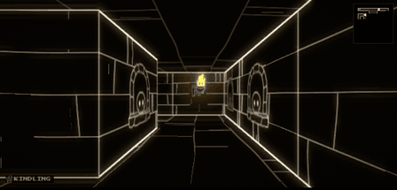
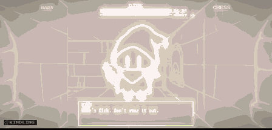
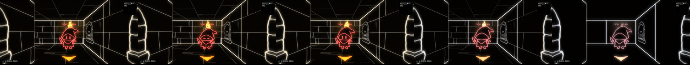
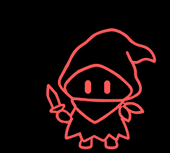
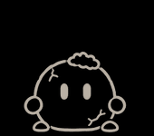
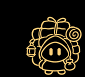
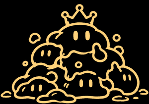
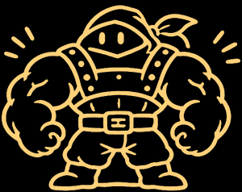
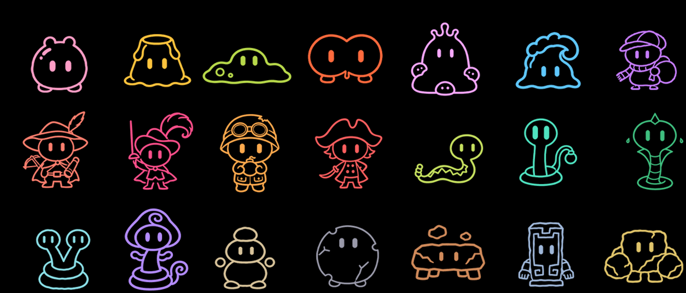

# 美术方案

> 可爱不是换皮。它是玩家能保住、也能亲手弄坏的东西。

这份文档写的是游戏里实际做成的样子，以及它和最初方案的差别。手绘的画面和世界对你的态度（warmth）已经是游戏本身，没有开关；`wick`（第一个朋友）和 `dungeon-reveal` 还有开关（`no-wick`、`no-dungeon-reveal`）。

## 为什么这样做

旧版的冷来自三个地方，新版一一对应地改：

| 旧版 | 新版 |
| --- | --- |
| 怪物是圆环眼加直线嘴，像在瞪人 | 头和帽子占大半，身体很小，眼睛是两颗发光的小药丸，没有嘴 |
| 怪物静止，只会滑动 | 蹦着走，落地压扁；注意到你时会抬头，开心和害怕都有整段动画 |
| 只有格子边线，地板和天花板全黑 | 砖缝、石板、墙饰都是画出来的，火把又大又实心 |

颜色只学了一半：墙面保持单色，怪物保留各自的颜色，冠军保留红色。

## 表情

表情从怪物的数值读出来（`rules/moods.gd`），所以会随着你的行为变化。

| 状态 | 什么时候 | 动作 |
| --- | --- | --- |
| 平常 | 没有强烈情绪 | 呼吸，隔几秒眨一次眼 |
| 开心 | 友好度过了它的门槛，或你刚做了它喜欢的事 | 眼睛笑弯，冒爱心 |
| 生气 | 怒气高，或正在追你，或你刚冒犯它 | 眼睛变斜，冒感叹号 |
| 害怕 | 恐惧高 | 小点眼，发抖 |
| 空白 | 世界太冷（见下） | 脸一点点消失，只剩线条 |

换心情时先倒放回平常，再正放新的，眼睛不会跳变。挨打和扑击直接切入，因为它们本来就该突然。

## 核心钩子：温度

世界有一个 0 到 1 的温度（`rules/warmth.gd`），开局 0.6。它不存盘，每次从这局已经记录的事推导，所以旧存档自动有温度，重试战斗时也会一起回退。数值在 `data/warmth.json`。

| 等级 | 温度 | 火把 | 骷髅 | 裂墙 |
| --- | --- | --- | --- | --- |
| 被爱 | 0.74 起 | 眼睛笑弯，路过时朝你弯 | 点头 | 心虚地笑 |
| 友善 | 0.46 起 | 看着你，朝你弯 | 点头 | 心虚地笑 |
| 戒备 | 0.28 起 | 看向别处，躲开你 | 不再点头 | 心虚地笑 |
| 闭眼 | 0.1 起 | 闭上眼睛 | 眼窝变空 | 只是裂缝 |
| 寒冷 | 0.1 以下 | 退回旧的线框火焰 | 眼窝变空 | 只是裂缝 |

饶恕和招募让世界变暖。杀戮和朋友离你而去让它变冷；屠宰朋友的代价比杀一只怪大得多，把朋友留在闸门也比杀一只怪更重。

随着世界变冷，砖缝和石板慢慢褪去，画面也失去颜色。怪物的脸一只一只变空白，每只在自己固定的温度变，冠军最后。到最冷时，地牢变回旧的线框：**现有的美术正好是残忍路线的终点**。

温度不改变任何数值，只改变这个地方怎么看你。

每层有一处墙上文字（`rules/lore.gd`）：死胡同尽头那面墙上一面更大的强调色横幅，挂在视线高度。读到哪一段也由读的那一刻的温度决定：友善或被爱读暖的那段，戒备读戒备的，闭眼或寒冷读冷的。

## 第一个朋友

开局的文字先说门：“It only opens for someone who is not alone.” 然后一个很小的女巫从走廊深处蹦过来，递给你一颗爱心。这个顺序是有意的：先告诉你孤身一人过不去，再让朋友出现。开场不挡操作，你一移动，她就已经和你同行了。

从 NEW GAME 进来时，前面还有一段 15 秒的影片（素材和 prompt 在 [intro/seedance-prompt.md](intro/seedance-prompt.md)），以她在走廊尽头挥手、头上冒心结束。完整看完的话，游戏里她不再重新蹦一次，直接在练习层带你走，并教你怎么走、怎么谈、怎么放过它；跳过影片的话，她照旧从走廊深处蹦来。

她叫 Wick，这里的火把都是她点的。所以火把才会看你；所以她走了、你残忍了，火把才会闭眼。

她是真正的队友，走现有的忠诚和离队规则：可以被你气走，可以留在闸门，也可以被屠宰。她不占队伍名额，也不加战斗力，所以平衡不受影响。最后那扇门仍然要靠“没有失去朋友”才能打开。

## 和最初方案的差别

| 方案 | 做成的样子 | 原因 |
| --- | --- | --- |
| 基调二选一 | 可爱但会被弄坏，黑暗系统全保留 | 屠宰和闸门只有在对象够可爱时才真正残忍 |
| 小女巫当朋友或商人 | 当第一个朋友；商人另画一个角色 | 第一个朋友才能让最后那扇门的条件从开局就成立 |
| 只改走路模型 | 走路和战斗用同一套图 | 同时解决了模型和战斗图不一致的问题 |
| 走到最坏变回线框 | 分五级，一路褪过去 | 一下跳变读不出是自己造成的 |
| 追杀靠“它们的脸不见了”才吓人 | 保留，再加：生气时自带动作，空白的脸不再回应你的话 | 恐惧来自你认识过这张脸 |
| 用姿势表做动画 | 改成 6×4 连续帧表 | 姿势表不连续，用参考图加连续帧才顺 |

新增而方案里没有的：战斗时走廊调暗留在怪物身后，所以战斗和世界是同一个地方；墙上有苔藓和蝙蝠；铁窗里挂小月亮。

## 素材

全部线稿由 Codex 生成（`codex exec`，用 ChatGPT 登录），再用脚本切成图集。流程见 [DEVELOPMENT.md](DEVELOPMENT.md#the-art)。

| 角色 | 动作 |
| --- | --- |
|  | 女巫 Wick，全部 8 段动作 |
|  | 强盗 |
|  | 史莱姆 |
|  | 蛇 |
|  | 石头 |
|  | 龙，也是冠军 |
|  | 商人，只有 4 段动作 |

四个族的领主各有一张自己的画（`tools/art/source/lords.png`，ChatGPT 画的，手工修过）。每个领主只有一张画，呼吸和眨眼是 `process.py` 把这张画变形做出来的：

| 领主 | 样子 | 会动的地方 |
| --- | --- | --- |
|  | 洞穴的领主：一堆粘在一起的史莱姆，顶上那只戴着王冠 | 整堆像果冻一样晃，王冠和水滴上下浮动，每只都会眨眼 |
|  | 帮派的领主：壮得好笑的强盗，只穿一件没有袖子的铁甲背心 | 吸气时胸和手臂鼓起来 |
|  | 古石的领主：一堆石头，留着长长的白胡子 | 胡子左右摆，碎石浮动；它没有眼睛可闭，所以抬眉毛 |
|  | 盘蛇的领主：有手有脚的蛇，像模特一样嘟嘴 | 挺胸，旁边的星光一闪一闪 |

领主比同族的怪物高，站在自己族的大厅尽头，仍然染成金色。胡子和蛇肚子是涂满的白色，图集里把内部调暗、只留亮边，否则发光会把它变成一盏灯。

停下来做选择时画面中间的小图（纪念品、营火、闸门、楼梯、最后的门、出口）原来是代码画的直线，现在也是手绘的（`tools/art/source/events.png`），由 `src/view/vignette.gd` 让其中一部分动起来：闸门的栅栏下沉又被链子拉起，火苗摇晃，光点在三件纪念品之间移动，出口的光一明一暗。

上图是 B1F 到 B5F 新加的 21 种怪物（`data/kinds.json`），从左上起依次是：软糖、喷吐怪、软泥、分裂怪、育母、潮汐、扒手、瞭望手、决斗者、工兵、船长、蝰蛇、凝视者、眼镜蛇、双头蛇、催眠蛇、卵石堆、巨石、震岩、碾压者、石魔像。每种的 8 段动作都是 Codex 按同一套 prompt 画的（`tools/art/prompts/<种类>.txt`），GIF 在 `docs/art/<种类>.gif`。每种怪用自己的颜色描线，同一氏族的几种形状各不相同，所以远远一眼就能看出是哪种。种类还没有图的时候，就用它所属物种的图。

图集的亮度通道是线条，透明通道是轮廓，所以身体内部是黑的，能挡住身后的东西，线条可以染成任何颜色。

## 剧情 CG

每个剧情时刻都有一张盖满全屏的手绘图，下面配这一刻的字，按任意键继续，期间游戏停住（`src/view/story_cg.gd`）。每局每张只出现一次；设置里的 STORY PICTURES 关掉后，墙上文字和氏族大厅退回原来的横幅。

| 时刻 | 图 | 什么时候 |
| --- | --- | --- |
| 开场 | `premise`：伸手去拿宝箱里的金币，金币挂在鱼线上，走廊像洗牌一样散开 | 新的一局，且前面没放开场影片 |
| 闸门 | `gate`：小强盗拽着闸门的链子，扭头不看你 | 第三层楼梯 |
| 最后的门 | `door`：一双手按在关着的门上 | 孤身走到最后的楼梯 |
| 结局 | `end_ghost` `end_quiet` `end_blood` `end_tangled` `end_lonely` | 按路线 |
| 氏族大厅 | `lord_burrow` `lord_crew` `lord_old_stone` `lord_coil`：领主坐在大厅尽头，族人分列两侧 | 走传送门进大厅 |
| 最后的冠军 | `vexalith`：老龙盘在金币山上，守着最后的门 | 遇到 VEXALITH |
| 墙上文字 | `lore_<层>_<warm/wary/cold>`，15 张 | 读墙 |

画风跟 keyart 一样（黑底白线，身体实心黑），线条按 `data/story.json` 的 `tint` 染色：暖的金色，戒备的骨白，冷的灰蓝，氏族用各自的颜色。玩家从不露脸，最多从画面下沿伸进来一双手。

出图：`tools/art/cg.sh [名字…]` 用 Codex 画（prompt 在 `tools/art/prompts/cg_*.txt`，共用 `_cg.txt`），keyart 当画风参考，角色参考由 `tools/art/cg_refs.py` 从原画表里裁出来，`sheets.json` 每张的 `refs` 写着用哪几个角色。挑好的用 `keep.sh cg_<名字> <编号>` 留下，再跑 `process.py` 缩到 1024 宽。

## 还能再做的

- 商人和请求者没有生气、受伤的动作，因为他们不打架。
- 冷色调只调了画面，音乐还没有跟着变冷。
- 空白的脸在战斗里不再回应情绪，但台词照旧。
