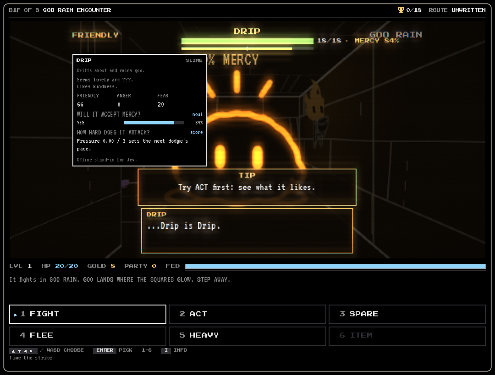

# The game

NEW GAME opens with a 15-second film (any key skips it): you look into a chest, fall through halls that reshuffle themselves, and a very small witch waves at the end of a corridor. Then the first run begins, on a practice floor if it is your first. The main menu has Continue, New Game, Load Game, the save manager, Legacy, Achievements, Settings, Credits and Quit. You robbed the Hoard, and it threw you down here: a run is five floors down to the Last Door, the only way out.

This page describes the game as it ships. A few features can be turned off one at a time with a flag ([Development](DEVELOPMENT.md#features)).

## Walking

Each floor belongs to a biome with its own generator, colours and monsters, and floors grow as you go down:

| Biome | How it is built | Size by floor | Lives here most |
| --- | --- | --- | --- |
| The halls | A maze with a hall in the middle | 21 to 37 | Bandits, rocks |
| The Undercroft | Authored rooms that nearly fit; half its floors are long or tall, not square | 31 to 55 | Rocks, bandits |
| The Wet Caves | Cave rock, no straight walls | 27 to 51 | Slimes, snakes |

**Every floor has its own five kinds of monster**, 25 in all, and no kind lives on two floors (`data/kinds.json`). Each of the four clans has at least one kind on every floor, so a clan's mood, its acts and the charm it gives as a friend carry on all the way down, while how it looks, how it moves and how it attacks change from floor to floor. A floor has one of each of its kinds and more on a bigger floor (the biome says of which clans); a warren holds every kind of its clan met so far, the floor's own first. The name over a monster's head is its kind; the map's legend lists the floor's five with their attacks.

The camera glides from cell to cell, and the automap in the corner learns what the camera sees. A champion stands on the stairs of every floor, hidden from the map until seen, so there is no way down without facing it. Beaten or won over, it leaves you stronger: 4 more max HP and 6 health back.

**A champion leaves keepsakes.** On every floor but the last, the champion out of your way leaves three keepsakes and you take one, yours for the rest of the run. The same run offers the same three on the same floor, and never one you already hold, so four champions make four choices out of nine. What you carry is listed beside the dodge box, and sitting down (Enter on the walk) says it too.

| Keepsake | What it does |
| --- | --- |
| EMBER HEART | 6 more max HP, and all your health back |
| SHARP TOOTH | Every strike of yours that lands does 2 more |
| STEADY HAND | The perfect mark on the strike bar is twice as wide |
| THICK HIDE | Every hit in the box costs 1 less (never less than 1) |
| QUICK FEET | A close call counts from 0.45 seconds out instead of 0.3, so nerve comes easier |
| DEEP BREATH | Every fight starts with 2 nerve |
| OPEN HAND | Every monster is 15% likelier to take mercy |
| LUCKY COIN | Half again as much gold from every purse and chest |
| SECOND WIND | Once a fight, the hit that would fell you leaves you on 1 HP |

Floors hide things: chests behind cracked walls (walk into a crack to break it), pads that carry you across the floor, items lying about, something stirring in plain sight that you can walk round or walk into, and on some floors someone who asks for a favour instead of a fight. Floors 2 and 4 have a trader.

**Monsters move when you move**, and turning is free. Slimes drift, bandits patrol, snakes follow for a while, and rocks and dragons stay put, and some kinds have their own ways: a gumdrop or a tide never stops moving, an adder, a pickpocket or a hypnocoil follows you, a boulder patrols, and spitters, lookouts, gazers, cobras, sappers, crushers, brood mothers and golems hold their ground; an angry monster, or one whose clan you have wronged, comes after you. One that has seen you is tagged HUNTING with an alert sound, one in sight makes a soft step as it moves, and an arrow at its feet shows the way it went. A monster that catches you starts the fight and strikes first.

**Hunger.** Walking slowly brings health back until you are hungry; starving, it costs you health every few steps. Press **Enter** to make camp and eat. Floors leave rations about, traders sell them, and going down a floor takes the edge off.

**The stairs** offer two ways down to compare, chosen from the seed: a steep stair (tougher monsters, more gold), a quiet one (fewer monsters, a longer rest), a market stair (a trader below) or a warren (every monster below is one kind). On the third stairs a gate drops unless someone holds its chain and stays: hold it yourself for 10 HP, or leave a friend behind, which the others see. The last stairs open only for someone with a friend; alone you can turn back, or take the lonely ending.

**The halls answer what you do.** Spare monsters and the corridor warms: torches grow eyes, turn to you and lean in as you pass, skulls nod, and a cracked wall that gives is a guilty smile. Kill and they look away, then shut their eyes; faces go blank one monster at a time, champions last, and at the bottom the set is cold wire. Eating or abandoning a friend costs more than a kill. Nothing here changes a number: it is how the place feels about you. See [ART.md](ART.md).

**Writing on the walls.** Every floor has one piece of writing, a banner in the accent colour on the closed end of a quiet corridor, marked in gold on the map once seen (grey once read). Step up to it to read it. What it says depends on the floor and on how the halls feel about you as you read: warm (kind or beloved), wary, or cold (shut or cold). So a kind run, a mixed one and a cruel one each read their own five of the fifteen, which tell why the halls fold up and drop the thief back on B1F, who scratched the tally on B2F, and why the Last Door wants two. What has been read is kept across runs, the log counts it ("Writing 4 of 15 found"), and reading all of it is an achievement. The words are in `data/lore.json`.

## Fights

- **FIGHT** is a timing bar: strike when the line crosses the middle. A hit sours the monster's mood.
- **HEAVY** is a faster line and a smaller mark for a harder hit, which some monsters take worse than others.
- **Friends follow through.** With monsters in your party, a FIGHT that lands doesn't stop the line: each friend has a mark further along the bar in its own colour, and each press after yours is the next friend's. On its mark that friend strikes for 3; off it, that friend's moment is gone, so hammering the key gets nothing. Not pressing costs nothing, and a HEAVY blow is too quick for them.
- **ACT** has CHECK (free, one clue at a time), three acts for that species, and SAY SOMETHING: type a line and ask about the stairs, the champion or another monster, or just try to win it over. What a monster likes and hates is found by trying it, and it answers in its own words: pleased, stung, hurt, scared or puzzled. Bandits and snakes can take a 6-gold cut to stand down; you start with 8.
- **ITEM** heals, sharpens your next strike, slips you out of the fight, or gives a gift a monster may love.
- **SPARE** rolls against the monster's mercy, shown as a gauge by its health with how far each deed moved it. Its name turns gold when the odds are at least even. It then asks to come along, and you answer.
- **FLEE** works except against a champion, and costs 2 gold. The monster keeps its wounds and holds a grudge.

Then the monster attacks, unless what you did calmed it. Monsters belong to clans that hear what you did: later ones say so and start in a different mood.

**Clans keep count.** A kill angers the monster's clan, half as much the clans on its side, and a quarter the Hoard; a champion counts one and a half. One kill of its own makes a clan ANGRY (its own start out angrier). Two, with nothing made up for them, make it FURIOUS: every floor reached after that has its kind as elites, tagged ELITE over their heads and in the header, with a quarter more health, faster attacks and a point more per hit (never the champion). Four make it ENRAGED: none of its own takes mercy, a cut or an offer, and SPARE greys out, even for a champion of the Hoard. Sparing one on its side, or doing one of its kind a favour, cools it back down. A banner says so whenever a clan moves.

**What makes it harder** is on the screen: the header tags how much tougher this floor's monsters are (FOES +12% HP for each floor below B1F, a quarter more down the steep stair), the map's legend (the info key on the walk) gives every clan's mood and what its levels mean, and an elite's or an enraged clan's fight opens with a banner saying which.

How long winning a monster over takes, from `tools/sim_recruit.gd` over 1000 seeds, playing the best ACT every time:

| Monster | Mercy odds at the start | ACTs to reach even odds | Join odds by then | Strikes to kill |
| --- | --- | --- | --- | --- |
| Slime | 13% | 1 | 81% | 2 |
| Bandit | 1% | 2 | 79% | 3 |
| Snake | 1% | 2 | 82% | 3 |
| Rock | 1% | 2 | 87% | 3 |
| Dragon | 0% | 4 | 79% | 7 |

A run with no strike in it reaches the end: `tools/autoplay.gd -- pacifist` does, 5 games of 5, and the test suite keeps it that way.

## The box: lit squares hurt

You dodge on a 7×7 grid. Each kind attacks in its own way, and its pace follows its friendliness, the floor, how you are doing and the EASY DODGE setting; your first fights go slower. The attacks get trickier as you go down: B1F teaches the four old ones, B2F adds things that move and traps to remember, B3F shapes that stay, B4F two-step tricks, and B5F mixes them.

| Floor | Kind (clan) | Attack | How it attacks | Bot hits |
| --- | --- | --- | --- | --- |
| B1F | Slime (slime) | Goo rain | Falling goo; watch where it will land | 0.75 |
| B1F | Gumdrop (slime) | Bounce | Gumdrops bounce round the box off the walls, squashing along a wall as they hit it | 0.40 |
| B1F | Bandit (bandit) | Chess | Rook (row and column), bishop (diagonals), knight (L-jumps), each shown by its shape and reach | 0.72 |
| B1F | Snake (snake) | Shadow | A lantern flares; hide in a pillar's shadow | 0.00 |
| B1F | Rock (rock) | Rhythm | It stomps on the beat; move between beats | 0.00 |
| B2F | Spitter (slime) | Spit | Globs fly down rows and columns; step out of a lane that glows | 0.45 |
| B2F | Pickpocket (bandit) | Traps | Traps flash for a moment, then hide until they spring; remember them | 0.00 (not its memory) |
| B2F | Lookout (bandit) | Crossfire | Bolts down your row, then your column, then your row again | 0.55 |
| B2F | Adder (snake) | Slither | A snake slithers after you; its head and body hurt | 0.38 |
| B2F | Pebbles (rock) | Rockfall | Stones land, then stay in your way for a while | 0.33 |
| B3F | Ooze (slime) | Puddles | Goo lands and stays as puddles; don't get cornered | 0.70 |
| B3F | Duelist (bandit) | Queen | A queen takes her row, column and both diagonals | 1.05 |
| B3F | Gazer (snake) | Gaze | A beam turns round the middle like a lighthouse, and turns back | 1.00 |
| B3F | Cobra (snake) | Venom | A ring closes round you; get out through its gap | 1.00 |
| B3F | Boulder (rock) | Roll | Boulders two lanes wide roll across | 0.85 |
| B4F | Splitter (slime) | Split | A big blob lands, then splits four ways | 0.97 |
| B4F | Sapper (bandit) | Bombs | Bombs count down 3, 2, 1, then blow along their row and column | 0.45 |
| B4F | Twinhead (snake) | Twin lanterns | Two lanterns flare in turn; hide from each behind a pillar | 1.02 |
| B4F | Quakestone (rock) | Quake | A stomp rings out across the box but for a crack running from it; stand in the crack | 0.65 |
| B4F | Crusher (rock) | Crush | The walls close in from two sides; be at the gap when they meet | 0.97 |
| B5F | Brood mother (slime) | Brood | Her babies hop after you, then pop | 1.38 |
| B5F | Tide (slime) | Tide | The tide floods all but an island, and the island moves | 1.30 |
| B5F | Captain (bandit) | Pawns | A rank of pawns marches at you, taking the squares diagonally ahead | 1.80 |
| B5F | Hypnocoil (snake) | Hypnosis | Left is right and up is down, and goo lands where it glows | 1.20 (not its mirror) |
| B5F | Golem (rock) | Fists | Its fists land where you stand, on the beat, then a sweep | 0.55 |
| Any | Champion (the Hoard) | All five | Every attack of its floor's kinds, one a turn | – |

Bot hits is how often a slow bot (it sees a warning 0.38 s after it shows and steps every 0.26 s) is hit in one dodge at the pace of a monster pressed a little (intensity 1.3), over 40 dodges; by floor it averages 0.37, 0.34, 0.92, 0.81 and 1.25. `tools/sim_dodge.gd` plays every attack with a bot that reads the warnings, over many seeds, and prints how often it is hit, how much of the box is lit, and whether any moment left no way out; `tools/kinds_test.gd` fails an attack that lights the whole box, walls you in, or lands on your square with less than 0.3 s of warning.

Every third attack is a mini-game instead: **walls** (be at the gap when one arrives), **stars** (catch them to heal, keep off the red) or **dance** (be on the light when the beat lands, to heal).

You start with 20 HP. A hit costs 3, or 4 from the champion. If you die you can try the fight again at full health.

**Nerve** is what holding your ground earns. A dodge with no hit in it gives a point, and so does every close call: stepping off a square in its last moments before it lands (its outline turns white for the last 0.3 seconds, and a ring flies off you when you make it). You hold up to five, shown as pips beside the box. The next FIGHT or HEAVY that lands spends them all for 2 more damage a point, or SPARE spends them for 8% better odds a point; a miss keeps them, and a hit shakes one out of you. A wall's columns count as one thing, so there is one close call in a wall.

**How it feels shows in its attack.** The word by a monster's name (WARY, ANGRY, AFRAID, FRIENDLY) is read off its meters. A friendly one's attack drops a heart now and then on a square nothing is coming for: catch it and it heals you 1 and pleases the monster, which moves its mercy with no deed of yours. A frightened one falters: one hazard in three never comes, and it breaks off a quarter early. An angry one presses harder, as before.

## The mind

Every monster has a species' tastes, its own traits and a motive, and meters for friendliness, anger and fear. Each act asks the mind how it feels, whether it would accept mercy and how hard it attacks. Hover the foe or press **I** to see its mood, what you have found out about it, and the mind's answers. Its health and mood sit over its head, and a bubble shows how a deed landed. The info key also keeps the talk so far.

Monsters think through one interface (`src/mind/`): local rules, a seeded random mind (`mock`), or Jev through the proxy (the default, `nojev` turns it off), falling back to the local rules whenever it can't answer.

## Allies

**Wick** finds you first. A run opens with a very small witch hopping down the corridor to hand you a heart; she lights the torches down here, and she walks with you from then on. On the practice floor she is the one who teaches: how to walk, what the slime is, ACT then SPARE, and the tips there are in her voice. She takes nobody's place in the party, adds no strength, and leaves the way any friend does: you can drive her off, leave her at the gate or put her in the bag.

Up to three spared monsters travel with you, and each gives a passive charm. Each also adds to your strikes, and two or more take the edge off every hit.

| Ally | Charm | Effect |
| --- | --- | --- |
| Slime | BOUNCY | Absorbs the first hit of every fight |
| Bandit | KEEN EYE | Warnings stay lit longer |
| Snake | SLIPPERY | Longer safety after you get hit |
| Rock | STEADY | The strike bar moves slower |
| Dragon | HOARD-FIRE | +4 damage on every strike |

Allies have values and judge what you do. Upset one enough and it walks out. Hover its chip or press **I** to see its mood, loyalty and what it cares about.

At camp a friend can also become two roasts: to eat, to sell to a trader who won't ask, or to feed to the others, who like you for it, until one works it out, walks out and tells. The ending remembers.

## What outlasts a run

A run that ends leaves embers, by what you did in it. On the main menu's Legacy page they buy boons every later run starts with: more max HP, gold, salves in the bag, a harder first strike. Deeds worth keeping go up on the picture as achievements (16 of them), and stay earned whichever slot you play.

## Routes and saves

The stairs name how you played: ghost (met no one), quiet (killed no one), blood (spared no one) or tangled.

A run is autosaved when a floor starts and whenever you are back to walking. The pause menu saves into six slots while you walk; a fight in progress isn't saved.
