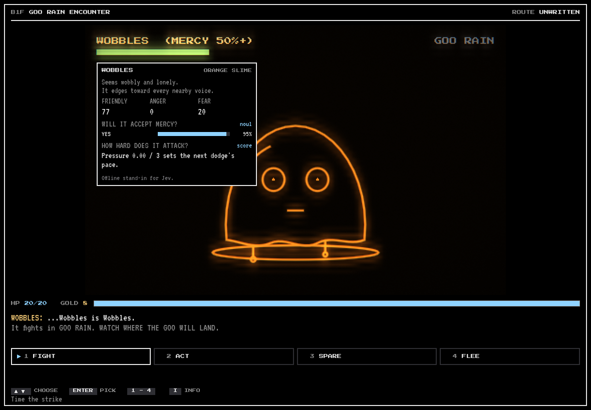

# The game

NEW GAME opens with a 15-second film (any key skips it): you look into a chest, fall through halls that reshuffle themselves, and a very small witch waves at the end of a corridor. Then the first run begins, on a practice floor if it is your first. The main menu has Continue, New Game, Load Game, the save manager, Legacy, Achievements, Settings, Credits and Quit. You robbed the Hoard, and it threw you down here: a run is five floors down to the Last Door, the only way out.

This page describes the game as it ships. A few features can be turned off with a flag ([Development](DEVELOPMENT.md#features)), and `classic` turns those off. The personality slice (`personality-slice`) is the old reference run: one 13×13 floor and no more than the fights.

## Walking

Each floor belongs to a biome with its own generator, colours and monsters, and floors grow as you go down:

| Biome | How it is built | Size by floor | Lives here most |
| --- | --- | --- | --- |
| The halls | A maze with a hall in the middle | 21 to 37 | Bandits, rocks |
| The Undercroft | Authored rooms that nearly fit; half its floors are long or tall, not square | 31 to 55 | Rocks, bandits |
| The Wet Caves | Cave rock, no straight walls | 27 to 51 | Slimes, snakes |

The camera glides from cell to cell, and the automap in the corner learns what the camera sees. A champion stands on the stairs of every floor, hidden from the map until seen, so there is no way down without facing it. Beaten or won over, it leaves you stronger: 4 more max HP and 6 health back.

Floors hide things: chests behind cracked walls (walk into a crack to break it), pads that carry you across the floor, items lying about, something stirring in plain sight that you can walk round or walk into, and on some floors someone who asks for a favour instead of a fight. Floors 2 and 4 have a trader.

**Monsters move when you move**, and turning is free. Slimes drift, bandits patrol, snakes follow for a while, and rocks and dragons stay put; an angry monster, or one whose clan you have wronged, comes after you. One that has seen you is tagged HUNTING with an alert sound, one in sight makes a soft step as it moves, and an arrow at its feet shows the way it went. A monster that catches you starts the fight and strikes first.

**Hunger.** Walking slowly brings health back until you are hungry; starving, it costs you health every few steps. Press **Enter** to make camp and eat. Floors leave rations about, traders sell them, and going down a floor takes the edge off.

**The stairs** offer two ways down to compare, chosen from the seed: a steep stair (tougher monsters, more gold), a quiet one (fewer monsters, a longer rest), a market stair (a trader below) or a warren (every monster below is one kind). On the third stairs a gate drops unless someone holds its chain and stays: hold it yourself for 10 HP, or leave a friend behind, which the others see. The last stairs open only for someone with a friend; alone you can turn back, or take the lonely ending.

**The halls answer what you do.** Spare monsters and the corridor warms: torches grow eyes, turn to you and lean in as you pass, skulls nod, and a cracked wall that gives is a guilty smile. Kill and they look away, then shut their eyes; faces go blank one monster at a time, champions last, and at the bottom the set is cold wire. Eating or abandoning a friend costs more than a kill. Nothing here changes a number: it is how the place feels about you. See [ART.md](ART.md).

## Fights

- **FIGHT** is a timing bar: strike when the line crosses the middle. A hit sours the monster's mood.
- **HEAVY** is a faster line and a smaller mark for a harder hit, which some monsters take worse than others.
- **ACT** has CHECK (free, one clue at a time), three acts for that species, and SAY SOMETHING: type a line and ask about the stairs, the champion or another monster, or just try to win it over. What a monster likes and hates is found by trying it, and it answers in its own words: pleased, stung, hurt, scared or puzzled. Bandits and snakes can take a 6-gold cut to stand down; you start with 8.
- **ITEM** heals, sharpens your next strike, slips you out of the fight, or gives a gift a monster may love.
- **SPARE** rolls against the monster's mercy, shown as a gauge by its health with how far each deed moved it. Its name turns gold when the odds are at least even. It then asks to come along, and you answer.
- **FLEE** works except against a champion, and costs 2 gold. The monster keeps its wounds and holds a grudge.

Then the monster attacks, unless what you did calmed it. Monsters belong to clans that hear what you did: later ones say so and start in a different mood.

How long winning a monster over takes, from `tools/sim_recruit.gd` over 1000 seeds, playing the best ACT every time:

| Monster | Mercy odds at the start | ACTs to reach even odds | Join odds by then | Strikes to kill |
| --- | --- | --- | --- | --- |
| Slime | 13% | 1 | 81% | 2 |
| Bandit | 1% | 2 | 79% | 3 |
| Snake | 1% | 2 | 82% | 3 |
| Rock | 1% | 2 | 87% | 3 |
| Dragon | 0% | 4 | 79% | 7 |

A run with no strike in it reaches the end: `tools/autoplay.gd -- pacifist` does, 5 games of 5, and the test suite keeps it that way.

## The box: lit squares hurt

You dodge on a 7×7 grid. Each faction attacks in its own genre, and its pace follows its friendliness, the floor, how you are doing and the EASY DODGE setting; your first fights go slower.

| Monster | Genre | How it attacks |
| --- | --- | --- |
| Slime | Goo rain | Falling goo; watch where it will land |
| Bandit | Chess | Rook (row and column), bishop (diagonals), knight (L-jumps), each shown by its shape and reach |
| Snake | Shadow | A lantern flares; hide in a pillar's shadow |
| Rock | Rhythm | It stomps on the beat; move between beats |
| Dragon (champion) | All four | Its rules change every turn |

Every third attack is a mini-game instead: **walls** (be at the gap when one arrives), **stars** (catch them to heal, keep off the red) or **dance** (be on the light when the beat lands, to heal).

You start with 20 HP. A hit costs 3, or 4 from the champion. If you die you can try the fight again at full health.

## The mind

Every monster has a species' tastes, its own traits and a motive, and meters for friendliness, anger and fear. Each act asks the mind how it feels, whether it would accept mercy and how hard it attacks. Hover the foe or press **I** to see its mood, what you have found out about it, and the mind's answers. Its health and mood sit over its head, and a bubble shows how a deed landed. The info key also keeps the talk so far.

Monsters think through one interface (`src/mind/`): local rules, a seeded random mind (`mock`), or Jev through the proxy, falling back to the local rules whenever it can't answer.

## Allies

**Wick** finds you first. A run opens with a very small witch hopping down the corridor to hand you a heart; she lights the torches down here, and she walks with you from then on. On the practice floor she is the one who teaches: how to walk, what the slime is, ACT then SPARE, and the tips there are in her voice. She takes nobody's place in the party, adds no strength, and leaves the way any friend does: you can drive her off, leave her at the gate or put her in the bag.

Up to three spared monsters travel with you, and each gives a passive charm. Each also adds to your strikes, and two or more take the edge off every hit.

| Ally | Charm | Effect |
| --- | --- | --- |
| Slime | BOUNCY | Absorbs the first hit of every fight |
| Bandit | KEEN EYE | Warnings stay lit longer |
| Snake | SLIPPERY | Longer safety after you get hit |
| Rock | STEADY | The strike bar moves slower |
| Dragon | HOARD-FIRE | +4 damage on every strike |

Allies have values and judge what you do. Upset one enough and it walks out. Hover its chip or press **I** to see its mood, loyalty and what it cares about.

At camp a friend can also become two roasts: to eat, to sell to a trader who won't ask, or to feed to the others, who like you for it, until one works it out, walks out and tells. The ending remembers.

## What outlasts a run

A run that ends leaves embers, by what you did in it. On the main menu's Legacy page they buy boons every later run starts with: more max HP, gold, salves in the bag, a harder first strike. Deeds worth keeping go up on the picture as achievements (16 of them), and stay earned whichever slot you play.

## Routes and saves

The stairs name how you played: ghost (met no one), quiet (killed no one), blood (spared no one) or tangled.

A run is autosaved when a floor starts and whenever you are back to walking. The pause menu saves into six slots while you walk; a fight in progress isn't saved.
