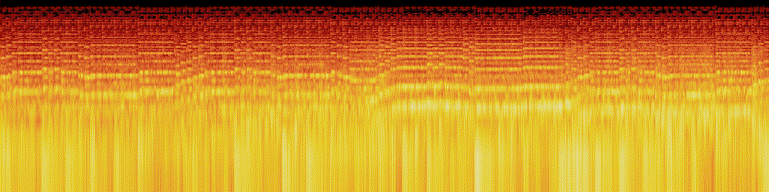

# Rebuilding the music

The game's music is written and rendered offline from sampled instruments, then encoded to Ogg Vorbis (Godot can't play
AAC). Every place and every foe has its own tune, in `assets/audio/music/`: 45 files, 28 MB. The camp keeps the one old
theme, Abdulla's hum theme (`assets/audio/hum-explore.ogg`, from `hum-theme/`). The game doesn't run any of this; you only
need it to change the music. What plays where is in [docs/AUDIO.md](../../docs/AUDIO.md).

| Script | Writes | What |
| --- | --- | --- |
| `build-themes.py` | `assets/audio/music/*.ogg` (and a WAV of each in `--wav-dir`) | every tune: the families, their head motifs and bands are tables at its top, and each tune's phrases are written from its own seed |
| `sampler.py` | | the offline sampler it plays through: decodes the soundfont samples, renders into a circular timeline, hall reverb, mastering |
| `to_ogg.sh` | `*.ogg` | WAV (or any audio file) to Ogg Vorbis; for a loop it cuts exactly one loop |
| `cut_motifs.sh` | `build/motifs/*.ogg` | Abdulla's motif audition, cut for the `motifs` trial (never shipped) |

## Rebuild

Needs numpy and scipy for the renders, and ffmpeg (with libvorbis) for the encode. From the repository root:

```bash
uv run --no-project --with numpy --with scipy python -I tools/music/build-themes.py            # all 45, in parallel, about a minute
uv run --no-project --with numpy --with scipy python -I tools/music/build-themes.py --list     # their names
uv run --no-project --with numpy --with scipy python -I tools/music/build-themes.py --only fight-gazer,hall-coil
godot --headless --path . --import   # Godot reads the new files; a new tune needs this once for its .import
```

The tune list comes from the game's data: a new kind in `data/kinds.json` or a new champion in `data/floors.json` gets
its tune on the next build, and `tools/audio_test.gd` fails until it has one.

## How a tune is written

A family is one melody idea: a mode, a metre, a tempo, a two-bar head motif, the rhythm cells its bars are made of, the
chord progressions it may take, a way of accompanying and a band. A tune is a family plus a key shift, a tempo factor,
which lead opens, which ostinato, and a seed. Its four phrases are: the head and an open ending, the head and a close,
a B phrase on the bridge's chords with the head's rhythm, and the head and another close. The bars after the head are
written note by note: a note of the chord on the strong units, steps and thirds between, drawn toward a rising and
falling contour, never three of the same note, a leap turned back. Fights play them as the tune, the B phrase with the
first lead an octave under, a break with the head on bells, and the tune again on another lead with an echo; places as
the tune, the B phrase, and the tune again.

Two tunes are written out whole instead: the Wet Caves' "Drip Lullaby" and Vexalith's "The Champion Stirs". Their
openings are the caves' and the Hoard's head motifs.

## How a loop file is cut

A render holds one loop plus a repeat of its first second (`sampler.py` `TAIL`), and it is circular: whatever
rings past the end wraps to the start, so any window one loop long is seamless. `to_ogg.sh loop` takes the window
that starts `LOOP_START` = 0.25 s into the render and lasts exactly `floor(seconds x 44100)` samples, so Godot's
gapless Ogg loop (`AudioStreamOggVorbis.loop`, which `src/audio/music.gd` sets on every tune but the stings) wraps
inside the music. The first 10 ms of the window are cross-faded with the audio that follows the window's end (the
repeated material), so the wrap is continuous even after the lossy encode. `build-themes.py` passes each tune's exact
length. The tunes are encoded at Vorbis quality 4 (`OGG_QUALITY`); `to_ogg.sh` defaults to 6.

## Levels

The renders are mastered to -19 dBFS RMS (exploring) and -17 dBFS RMS (fights and stings) by `sampler.py`; `VOLUME`
in `src/audio/music.gd` (0.7 and 0.75) puts a fight about 2.6 dB above the exploring music. Each build logs every
part's loudness per section against the mix, so the lead can be read against the band without ears, and the share of
the spectrum under 120 Hz (the kettle drums are held between E2 and D#3 so it stays under about 20%). Check an encode
with `ffmpeg -i assets/audio/music/fight-slime.ogg -af astats -f null - 2>&1 | grep -E "Overall|RMS level|Peak level"`;
it should read about -17 dB RMS.
