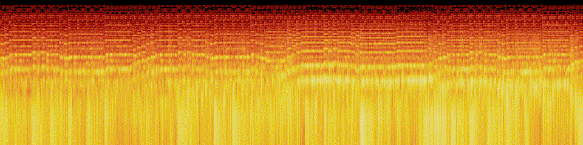

# Rebuilding the music

The game's music is rendered offline from sampled instruments, then encoded to Ogg Vorbis (Godot can't play AAC).
The seven files live in `assets/audio/`: `ambient.ogg` (exploring), `battle-toccata|charge|crusade|gallop.ogg`
(fights) and the stings `fanfare.ogg`, `victory.ogg`. You only need this folder to change the music; the game
doesn't run any of it.

| Script | Writes | What |
| --- | --- | --- |
| `sampler.py` | | the offline sampler the others share: decodes the soundfont samples, renders into a circular timeline, hall reverb, mastering |
| `build-ambient.py` | `ambient.wav` | the exploring passacaglia in D minor, 40 bars of 3/4 at 64 BPM = 112.5 s |
| `build-battle.py` | `battle-<name>.wav` | the four fight loops, 16 bars of 4/4 each: toccata 132 BPM, charge 126, crusade 112, gallop 120 |
| `build-stings.py` | `fanfare.wav`, `victory.wav` | the one-shot cues |
| `to_ogg.sh` | `*.ogg` | WAV (or any audio file) to Ogg Vorbis; for a loop it cuts exactly one loop |

## Rebuild

Needs numpy and scipy for the renders, and ffmpeg (with libvorbis) for the encode. From the repository root:

```bash
uv venv /tmp/donjon-music-venv && source /tmp/donjon-music-venv/bin/activate && uv pip install numpy scipy

python3 tools/music/build-ambient.py /tmp      # /tmp/ambient.wav
python3 tools/music/build-battle.py /tmp       # /tmp/battle-toccata.wav, -charge, -crusade, -gallop
python3 tools/music/build-stings.py /tmp       # /tmp/fanfare.wav and /tmp/victory.wav

tools/music/to_ogg.sh loop  /tmp/ambient.wav         assets/audio/ambient.ogg         112.5
tools/music/to_ogg.sh loop  /tmp/battle-toccata.wav  assets/audio/battle-toccata.ogg  3840/132
tools/music/to_ogg.sh loop  /tmp/battle-charge.wav   assets/audio/battle-charge.ogg   3840/126
tools/music/to_ogg.sh loop  /tmp/battle-crusade.wav  assets/audio/battle-crusade.ogg  3840/112
tools/music/to_ogg.sh loop  /tmp/battle-gallop.wav   assets/audio/battle-gallop.ogg   3840/120
tools/music/to_ogg.sh sting /tmp/fanfare.wav         assets/audio/fanfare.ogg
tools/music/to_ogg.sh sting /tmp/victory.wav         assets/audio/victory.ogg

godot --headless --path . --import   # Godot reads the new files (the loop flag of the five loops is kept in their .import files)
```

`sampler.py` reads the six MusyngKite sets it plays (CC BY-SA 3.0) from `soundfonts/` beside it.

## How a loop file is cut

A render holds one loop plus a repeat of its first second (`sampler.py` `TAIL`), and it is circular: whatever
rings past the end wraps to the start, so any window one loop long is seamless. `to_ogg.sh loop` takes the window
that starts `LOOP_START` = 0.25 s into the render and lasts exactly `floor(seconds x 44100)` samples, so Godot's
gapless Ogg loop (`AudioStreamOggVorbis.loop`) wraps inside the music. The first 10 ms of the window are cross-faded
with the audio that follows the window's end (the repeated material), so the wrap is continuous even after the
lossy encode.

Three numbers must agree, and `tests/audio/test_ambient.gd` checks them:

- the loop length: `TRACKS` in `src/audio/ambient.gd` (`loopSeconds`) and the last argument of `to_ogg.sh loop`;
- `LOOP_START` in `src/audio/ambient.gd` and `LOOP_START_SAMPLES` in `to_ogg.sh`: beat 0 of a render sounds 0.25 s
  before the start of its file, which is what `Ambient.beat_clock()` reports to the heartbeat;
- the length of the `.ogg` the game ships, within 10 ms of `loopSeconds`.

If you change a tempo or the number of bars, update `loopSeconds` too.

## Levels

The renders are mastered to -19 dBFS RMS (exploring) and -17 dBFS RMS (fights and stings) by `sampler.py`; the
volumes in `TRACKS` / `STINGS` (0.7 and 0.75) put a fight about 2.6 dB above the exploring music. Check an encode
with `ffmpeg -i assets/audio/battle-toccata.ogg -af astats -f null - 2>&1 | grep -E "Overall|RMS level|Peak level"`;
it should read -17 dB RMS and a peak around -2 dB.

## Converting the old `.m4a` files

The Godot port started from the web version's `.m4a` files, which live on in git history. The same `to_ogg.sh` takes
them, because ffmpeg decodes AAC and removes its priming and padding, so a decoded file is exactly one loop plus the
one-second tail:

```bash
git show 12d2be7:crawler/public/ambient.m4a > /tmp/ambient.m4a
tools/music/to_ogg.sh loop /tmp/ambient.m4a assets/audio/ambient.ogg 112.5
```
